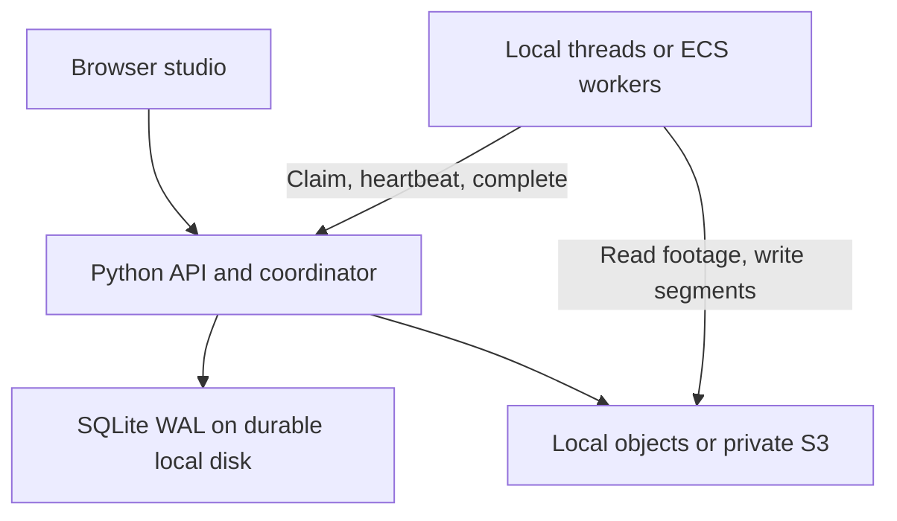

# BranchFrame

**Git-style collaboration for video, backed by a durable cloud rendering pipeline.**

Branch a timeline, commit an edit, compare revisions, resolve conflicting changes, and render the approved direction without overwriting the original footage.

Built as a cloud/backend engineering portfolio project. The application runs locally with Python and FFmpeg; AWS infrastructure provisions private S3 media storage, an HTTPS API host, and independent ECS Fargate render workers.

## What you can do

- Create private projects and invite registered teammates as editors or reviewers.
- Upload MP4, MOV, M4V, and WebM footage in resumable, SHA-256-verified 5 MiB parts (250 MiB per file).
- Add clips to a timeline, reorder them, trim in/out points, mute source audio, and add captions.
- Save immutable commits, create branches from any revision, and inspect field-level differences.
- Merge branches using a common ancestor. Resolve conflicting captions, trims, deletions, and ordering explicitly.
- Attach timestamped comments, approvals, and change requests to an exact commit.
- Export normalized 720p MP4 videos. Render clip segments concurrently, cache unchanged segments, then assemble the final video.
- Recover abandoned work through leases, heartbeats, bounded retries, and rejection of stale worker results.

## Run locally

Requires Python 3.12+; no Node.js build step is needed.

```sh
python3 -m venv .venv
source .venv/bin/activate
python -m pip install -r requirements.txt
python run.py
```

Open **http://127.0.0.1:8000** and create an account. `imageio-ffmpeg` supplies the optional rendering binary. An existing system FFmpeg/ffprobe installation also works. Without either, editing and version control work while export jobs wait for a renderer.

On Windows, activate with `.venv\Scripts\activate`.

### VS Code

Open this folder in VS Code, select `.venv` as the Python interpreter, and choose **Run and Debug → BranchFrame: local studio**. The repository includes launch configurations and tasks for running, testing, and Docker.

### Docker

```sh
docker compose up --build
```

This installs FFmpeg and caption fonts inside the image and stores project data in a named volume. The development port binds only to localhost.

## A five-minute demo

1. Create a project, upload a short video, and add it to the timeline.
2. Trim the clip, add a caption, and commit with a meaningful message.
3. Create a `social-cut` branch. Change the caption and commit.
4. Switch to `main`, change that same caption differently, and commit.
5. Open **Compare & merge**, select `social-cut`, and compare. Choose which caption to keep, then merge.
6. Inspect **Version history**: the merge commit has two parents. Add a timestamped review.
7. Export the commit. Watch segment and assembly jobs in **Exports**, then play/download the MP4.
8. Export the same commit again: the cached segment count increases.

For failure recovery, stop a remote worker during a job. A remaining worker can reclaim its work after the 120-second lease expires. Jobs get at most three processing attempts.

## Architecture



The coordinator owns metadata transactions; remote workers never open the coordinator's SQLite file. SQLite is intentionally a single-host dependency, not a database shared across machines. [Architecture and tradeoffs](docs/ARCHITECTURE.md) explain the queue, merge algorithm, cache, and scaling limits.

## Tests

```sh
python -m unittest discover -v
```

The suite covers merge rules, invalid trims, cross-project access, reviewer permissions, optimistic locking, upload integrity/resume, lease reclamation, duplicate claims, retries, cache reuse, and real FFmpeg segment encoding/assembly. Rendering tests skip explicitly if FFmpeg is unavailable. GitHub Actions installs FFmpeg before running the suite and builds the Docker image.

## Cloud deployment

See [AWS deployment](docs/AWS.md) for Terraform setup, required account inputs, image publishing, backups, costs, and cleanup. The AWS infrastructure has **not been deployed as part of the initial local build**; do not claim cloud performance numbers without running and measuring that deployment.

## Design handoff

A functional responsive interface is included. [UI/Figma brief](docs/UI_DESIGN.md) lists screens, flows, states, and implementation files so a new visual design can be applied without rebuilding the backend.

## Scope and limitations

- The editor previews original footage. Trims, captions, and mute are applied in exports; it is not a frame-accurate browser compositing engine.
- One sequential video track with each clip's own audio. No transitions, separate music track, arbitrary effects, or simultaneous live co-editing.
- Reviews are advisory; an approval does not lock a branch or block exports.
- Branch updates use optimistic concurrency: stale edits are rejected instead of silently overwriting another teammate's commit.
- Workers scale independently, but the coordinator and metadata disk are a single point of failure. AWS worker count is configured explicitly; autoscaling is not implemented.
- Uploads pass through the API and stage on its disk before S3 storage; this is not browser-to-S3 presigned upload.
- Local object and render caches do not yet evict themselves. Monitor disk usage; stale unfinished uploads are cleaned when another upload starts after 24 hours.
- This is a portfolio implementation, not a hardened public SaaS: no email verification, password reset, billing, MFA, or abuse prevention. Keep AWS demo access restricted to your IP.

## Project layout

| Path | Purpose |
|---|---|
| `branchframe/domain.py` | Validation, deterministic merge, ancestry and diff |
| `branchframe/server.py` | API, sessions, ACLs, commits, durable queue |
| `branchframe/uploads.py` | Resumable part upload and completion |
| `branchframe/store.py` | SQLite transactions and local/S3 objects |
| `branchframe/worker.py` | FFmpeg pipeline and remote worker loop |
| `web/` | Responsive browser studio |
| `tests/` | Domain, API, upload and real rendering tests |
| `infra/` | Terraform and API bootstrap |
| `.github/workflows/` | Tests, container build and optional ECR publishing |

MIT licensed. No cloud credentials, user accounts, uploaded footage, or generated exports are committed.
